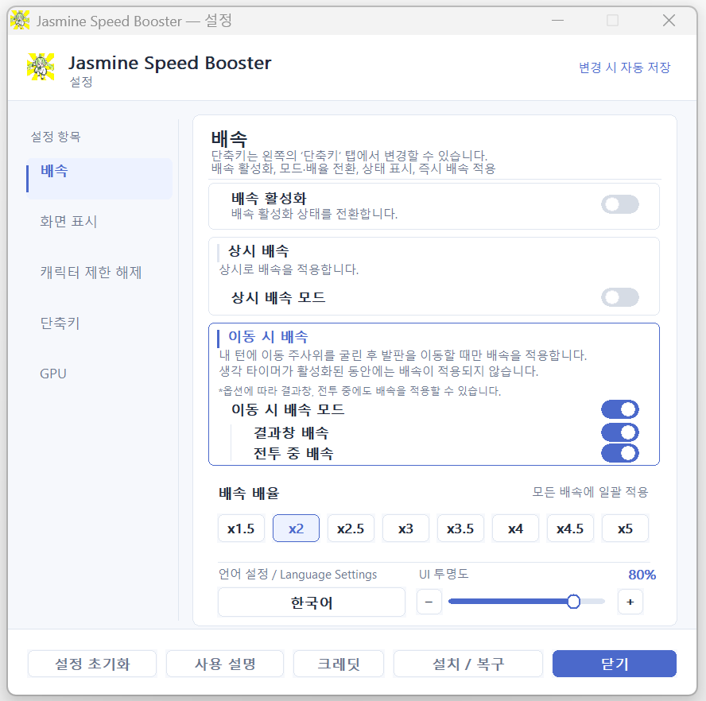
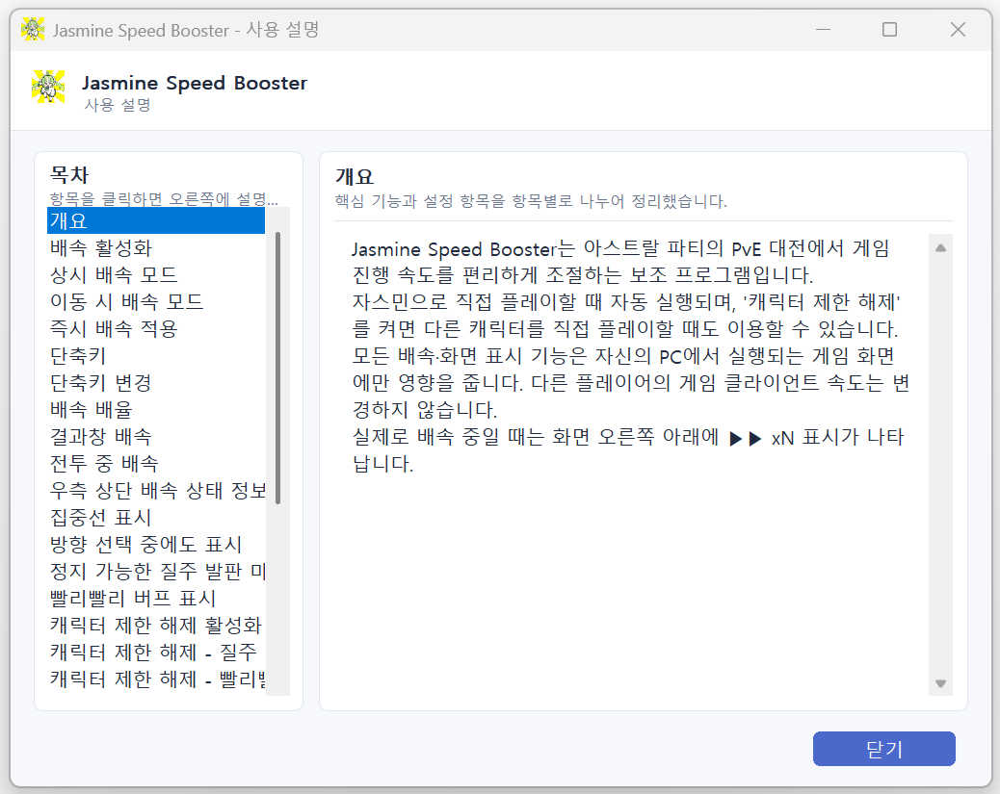

# Jasmine Speed Booster

**자스민 스피드 부스터(Jasmine Speed Booster)** 는 《아스트랄 파티》의 게임 진행 속도를 조절하고, 자스민의 질주 플레이에 맞춘 연출과 편의 기능을 제공하는 Windows용 비공식 배속 프로그램입니다.

두 가지 배속 모드와 사용자 지정 단축키, 게임 화면에 어우러지는 오버레이 및 질주 관련 안내 기능을 제공합니다.

## 설치 및 실행

1. [GitHub Releases](https://github.com/Shushu1121/JasmineSpeedBooster-Releases/releases/latest)에서 Windows ZIP을 다운로드해 **압축을 완전히 풉니다.**
2. 게임을 종료한 상태에서 `dist/JasmineSpeedBooster.exe`를 실행합니다.
3. 게임 설치 경로를 확인하면 필요한 구성요소가 설치됩니다.
4. 이후 PvE 대전에 참가하면 부스터가 자동 실행되며, 대전에서 나가면 자동 종료됩니다.

기존 모드 파일은 보존하도록 설계되어 있습니다. 첫 설치 후 게임 실행에 시간이 더 걸릴 수 있습니다.

## 최신 버전 다운로드

**v1.0.0 — [최신 버전 다운로드 (GitHub Releases)](https://github.com/Shushu1121/JasmineSpeedBooster-Releases/releases/latest)**

배포 파일: `JasmineSpeedBooster_v1.0.0_Windows.zip`

## 주요 기능

### 1. 생각할 시간은 그대로, 지루한 연출은 빠르게!

일반적인 배속 방식인 **상시 배속**과 게임 진행 상황에 따라 가속하는 **이동 시 배속**, 두 가지 모드를 지원합니다.

- **상시 배속:** 설정한 배속을 게임 진행 내내 적용하는 방식입니다.
- **이동 시 배속:** 자신의 턴에서 주사위를 굴린 뒤 발판을 이동하는 구간을 중심으로 가속하는 방식입니다. **화면 하단의 생각 타이머가 진행되는 동안에는 원래 속도를 유지**하여 다음 행동을 충분히 고민할 수 있습니다.

특히 이동 시 배속 모드에서는 **전투 중 배속과 결과창 배속도 각각 설정**할 수 있습니다. 자신의 캐릭터가 참여하는 전투의 애니메이션이나 승패가 결정된 뒤의 결과 연출까지 빠르게 진행하면서도, 전투 중 행동을 선택하거나 다음 수를 고민하는 시간은 그대로 확보할 수 있습니다.

즉, **충분히 생각해야 할 순간은 여유롭게, 시간을 많이 차지하는 이동·전투·결과 연출은 빠르게** 즐길 수 있습니다.

배속 배율은 x1.5 / x2 / x2.5 / x3 / x3.5 / x4 / x4.5 / x5의 **8단계** 중에서 선택할 수 있습니다.

### 2. 자스민의 질주를 더욱 역동적으로! 집중선 애니메이션


배속이 적용된 상태로 발판 사이를 이동할 때 화면에 **만화풍 집중선 애니메이션**이 펼쳐집니다.

빠르게 달려 나가는 듯한 속도감을 시각적으로 강조하여, 자스민 특유의 질주 플레이에 박진감과 몰입감을 더합니다. 설정에 따라 갈림길에서 이동 방향을 선택하는 동안에도 집중선을 표시할 수 있습니다.

### 3. 화면 밖의 질주 발판도 놓치지 않도록!


자스민에게 중요한 **질주 발판**을 더욱 편리하게 활용할 수 있도록 방향 안내 기능을 제공합니다.

주사위를 굴려 이동할 때, 도착할 수 있는 질주 발판이 화면 밖에 있다면 **해당 발판의 방향을 가리키는 안내 마크**가 화면 가장자리에 나타납니다. **바리케이드 등의 방해물로 인해 이동 도중 멈추는 경우**도 고려하여, 실제로 도착할 수 있는 질주 발판을 안내합니다.

안내 마크는 아스트랄 파티의 UI 디자인에 맞춰 제작되어, 기존 게임 화면과 자연스럽게 어우러집니다.

### 4. 놓치기 쉬운 '빨리빨리' 버프도 한눈에!


자스민의 플레이에서 중요하지만 자칫 놓치기 쉬운 **'빨리빨리' 버프의 보유 여부**를 직관적으로 확인할 수 있습니다.

버프를 보유하면 게임 화면의 이동 버튼 위에 **날개 달린 장화 모양의 애니메이션**이 표시됩니다.

기존 게임 UI와 자연스럽게 어우러지는 연출로, 별도의 상태창을 확인하지 않고도 버프 보유 여부를 쉽게 파악할 수 있습니다.

### 5. 간편한 조작과 게임 화면에 어우러지는 배속 UI


단축키로 배속 모드와 배율을 빠르게 전환할 수 있으며, **모든 단축키를 원하는 키로 자유롭게 변경**할 수 있습니다.

또한 지정한 키를 누르고 있는 동안에만 일시적으로 배속하는 **즉시 배속 기능**도 제공하여, 필요한 순간에만 간편하게 게임 진행 속도를 높일 수 있습니다.

현재 선택한 배속 모드와 배율, 실제 배속 작동 상태는 **게임 UI와 자연스럽게 어우러지는 오버레이**에 표시됩니다. 별도로 설정 창을 열지 않고도 현재 배속 상태를 직관적으로 확인할 수 있습니다.

### 6. 자스민 외 다른 캐릭터도 사용 가능!

자스민을 플레이할 때 사용하는 것을 염두에 두고 제작되었지만, 자스민 전용 프로그램은 아닙니다.

설정의 **캐릭터 제한 해제** 옵션을 활성화하면 다른 캐릭터로 플레이할 때도 배속 기능을 사용할 수 있습니다. 집중선 애니메이션이나 질주 발판 안내 등의 표시 기능도 개별 옵션으로 활성화할 수 있습니다.

### 7. 간편한 설치와 자동 실행·종료

게임 설치 경로를 확인하면 필요한 구성요소를 설치하거나 복구할 수 있습니다. **PvE 대전 시작 시 부스터가 자동으로 실행되고, 대전에서 나가거나 게임을 종료하면 자동으로 종료**됩니다.

### 8. 다국어 지원과 상세한 사용 설명




**지원 언어:** 한국어 · English · 日本語 · 中文

프로그램의 설정 화면과 사용 설명에서 4개 언어를 지원합니다.

각 기능의 작동 조건과 설정 방법, 단축키 사용법 등 자세한 내용은 프로그램의 **설정 → 사용 설명**에서 확인할 수 있습니다.

## 기본 단축키

| 키 | 기능 |
|---|---|
| `` ` `` (백틱) | 배속 ON/OFF |
| `1` | 이동 시 ↔ 상시 모드 전환 |
| `2` | x2 ↔ x4 빠른 배율 전환 |
| `3` | 우측 상단 배속 정보 표시/숨기기 |
| 왼쪽 `Shift` | 누르는 동안 즉시 배속 |

모든 단축키는 설정 창의 **단축키** 탭에서 변경할 수 있습니다. 숫자 단축키는 키보드 윗줄 숫자 키입니다. 다른 배율에서 `2`를 누르면 x2로 전환됩니다. 왼쪽 Shift는 배속을 꺼 둔 상태에서도 작동합니다.

## 설정 및 제거

게임 밖에서는 `JasmineSpeedBooster.exe`를 다시 실행하고, 게임 중에는 **Windows 트레이 아이콘**을 클릭해 설정 창을 엽니다. 설정은 즉시 적용되고 자동 저장됩니다.

기본 설정은 **배속 ON · 이동 시 · x2**입니다. 다른 캐릭터에도 적용하려면 **캐릭터 제한 해제**를 켜세요.

제거할 때는 게임과 부스터를 종료한 뒤 `dist/JasmineSpeedBooster_Uninstall.exe`를 실행합니다. 제거 후 압축을 푼 폴더를 삭제하면 됩니다.

## 지원 환경

- **Windows 10/11**, 아스트랄 파티 **Steam Global/INT**, **PvE 대전**
- **권장:** 주 모니터 전체화면, 1920×1080(16:9)
- 창모드는 지원하지 않으며, 다른 해상도나 화면 배율에서는 일부 표시 위치가 어긋날 수 있습니다.

## 제작 목적 및 동작 방식

자스민 스피드 부스터는 **플레이어 개인의 게임 플레이 편의성과 화면 가독성 향상**을 위해 제작되었습니다. 게임 서버나 다른 플레이어에게 피해를 주거나 게임의 승패·보상 등을 부정하게 조작하기 위한 목적으로 제작되지 않았습니다.

게임에 설치되는 BepInEx 플러그인(`JasmineMovementProbe.dll`)이 클라이언트의 로컬 IL2CPP 상태를 확인하고 배속 기능을 제어합니다. 별도의 화면 표시 프로그램과는 **Windows 로컬 공유메모리**를 통해 배속 상태와 화면 표시 정보를 주고받습니다.

현재 확인된 구현 범위에 다음 기능은 없습니다.

- 게임 서버 패킷 가로채기·변조·위조 및 네트워크 트래픽 조작
- 자동 입력·매크로·자동 플레이
- 게임 재화·캐릭터 능력치·전투 승패·보상값을 임의로 변경하는 기능

다만 **배속을 위해 게임 클라이언트의 시간 진행을 제어**하며, 결과 화면 연출을 빠르게 넘기기 위한 클라이언트 측 처리도 포함되어 있습니다. 따라서 게임 실행에 영향을 전혀 주지 않는 단순 정보 표시 프로그램은 아닙니다.

## 개인정보 및 로컬 데이터

현재 버전에는 별도의 계정 생성, 비밀번호 입력이나 개인정보를 외부 서버로 전송하는 기능이 구현되어 있지 않습니다. 플러그인과 화면 표시 프로그램 사이의 정보 교환은 같은 PC의 **Windows 로컬 공유메모리**를 사용합니다.

- 게임 설치 경로를 찾기 위해 PC에 저장된 **Steam 설정·라이브러리 경로**를 읽을 수 있습니다.
- 게임 경로와 프로그램 설정은 `%LOCALAPPDATA%\JasmineSpeedBooster\settings.ini`, `booster-settings.json` 등에 저장될 수 있습니다.
- 실행 상태 및 문제 분석을 위한 로그가 같은 폴더의 `JasmineSpeedBooster.log`, `launcher.log` 등에 기록될 수 있습니다. BepInEx 로그는 게임 설치 폴더에도 남을 수 있습니다.
- 오류 문의를 위해 로그를 공유할 때는 **로컬 파일 경로 등 개인 환경 정보가 포함되어 있는지** 확인해 주세요.

## 비공식 도구 및 이용 책임

이 프로그램은 《아스트랄 파티》 개발사·배급사의 공식 제품이나 공식 지원 도구가 아닙니다. 게임 프로세스에 BepInEx 플러그인을 로드하는 비공식 모드이며, 제작 목적이나 위 기능 설명은 **게임사·배급사의 사용 승인이나 이용약관상 허가를 의미하지 않습니다.**

게임 업데이트, 운영정책·클라이언트 구조 변경으로 작동이 중단되거나 문제가 발생할 수 있습니다. 이용자는 게임의 이용약관 및 운영정책을 확인하고 본인의 판단과 책임으로 사용해야 합니다.

프로그램은 관련 법령상 허용되는 범위에서 별도의 보증 없이 제공됩니다. 원제작자는 관련 법령상 허용되는 범위에서 프로그램 사용에 따른 게임 실행 문제, 설정·데이터 손실, 계정 이용 제한·제재, 다른 프로그램·모드와의 충돌 등 직접·간접적인 손해를 보증하거나 책임지지 않습니다.

## 이용 및 배포 조건

Jasmine Speed Booster는 **오픈소스로 제공되는 프로그램이 아니며**, 명시적으로 허용된 경우를 제외한 권리는 원제작자에게 유보됩니다.

**공식 배포처:** https://github.com/Shushu1121/JasmineSpeedBooster-Releases

원제작자가 공식 GitHub 및 Releases에 직접 게시한 **원본 배포 ZIP**은 다음 조건을 지키는 경우 비상업적으로 공유·재배포할 수 있습니다.

- 원제작자 및 공식 배포처를 명확히 표시해야 합니다.
- 실행 파일, 문서, 라이선스·저작권 고지 등 원본 구성요소를 **변경하거나 제거하지 않은 상태**로 공유해야 합니다.
- 판매, 유료 배포, 광고·수익 창출 목적의 배포 등 상업적 이용은 허용되지 않습니다.
- 제작자 사칭, 원본 출처 삭제·변경, 공식 버전 사칭은 허용되지 않습니다.
- 수정본·재포장본·파생물의 공개 재배포에는 **원제작자의 사전 허가**가 필요합니다.
- 위 조건을 위반하면 본 조건에 따른 공유·재배포 허가는 종료됩니다.

정확한 허용 범위와 조건은 [LICENSE.txt](LICENSE.txt)를 확인해 주세요. 본 README는 라이선스를 대체하지 않습니다.

게임의 명칭·캐릭터·이미지·로고·이펙트 등은 각 권리자에게 귀속되며, 자스민의 라이선스는 해당 게임 자산에 대한 별도 사용·재배포 권한을 부여하지 않습니다. BepInEx와 기타 제3자 구성요소에는 각자의 라이선스가 적용되며 배포 ZIP의 `THIRD_PARTY_NOTICES.txt`, `LICENSES/`에 고지를 동봉합니다.

## 배포 파일 확인

공식 배포 파일은 `JasmineSpeedBooster_v1.0.0_Windows.zip`이며, 압축 해제 시 다음과 같은 `dist` 폴더가 제공됩니다.

```text
JasmineSpeedBooster_v1.0.0_Windows.zip
└─ dist/
   ├─ JasmineSpeedBooster.exe
   ├─ JasmineSpeedBooster_Uninstall.exe
   ├─ README_KO.txt
   ├─ RELEASE_NOTES.txt
   ├─ LICENSE.txt
   ├─ THIRD_PARTY_NOTICES.txt
   ├─ JasmineSpeedBooster.build.json
   ├─ SHA256SUMS.txt
   └─ LICENSES/
```

`LICENSE.txt`는 프로그램 자체의 이용·배포 조건이며, `THIRD_PARTY_NOTICES.txt`와 `LICENSES/`는 제3자 구성요소 고지입니다. `SHA256SUMS.txt`는 `dist` 내부 배포 파일의 SHA-256 확인용입니다. GitHub Releases에는 **ZIP 전체를 확인하기 위한 별도의 `.sha256` 파일**도 함께 제공합니다.

실행 파일의 디지털 서명이 없는 배포 환경에서는 Windows SmartScreen이나 보안 프로그램이 경고를 표시할 수 있습니다. 공식 배포처에서 다운로드했는지 확인하고, 필요하면 제공된 SHA-256 값을 대조해 주세요.

**크레딧:** 렌이좋은데슈슈쉴드자꾸날려먹어서답답했던아붕이
